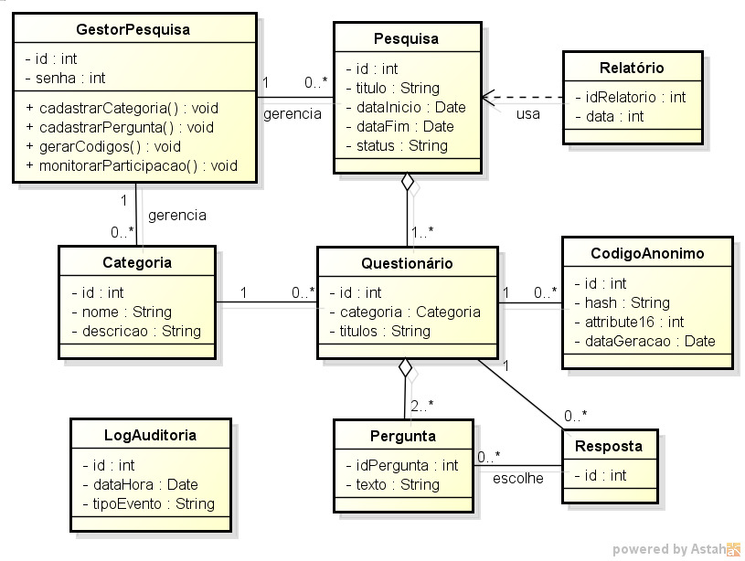

# 🛠️ Engenharia de Software II

**Disciplina:** Engenharia de Software II  
**Professor:** Prof. Rafael Hamamura  

## 📂 Descrição da Pasta
Esta pasta é dedicada à documentação técnica de modelagem do sistema e especificação de requisitos.

## 📄 Conteúdos Esperados
* `requisitos.md`: Documentação de Requisitos Funcionais e Não-Funcionais.
* `modelagem-uml/`: Diagramas UML (Casos de Uso, Classes, Sequência, etc.).

## Diagrama de Classes

Diagrama UML desenvolvido para representar as classes, atributos e relacionamentos do Sistema Web de Pesquisas Institucionais.

### Diagrama 1

### Diagrama 2

