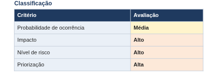
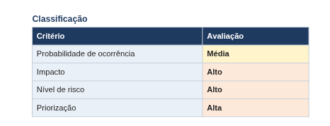
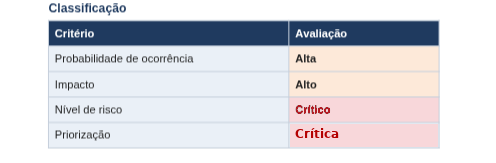

# Análise e mapeamento de risco do sistema de pesquisa

Este documento apresenta a identificação, análise e classificação dos possíveis riscos de segurança relacionados ao **Sistema Web de Pesquisas Institucionais**.

Os riscos identificados foram avaliados considerando a **probabilidade de ocorrência, o impacto potencial e o nível de criticidade**, permitindo estabelecer prioridades de tratamento.

Para cada risco, foi elaborado um plano de ação com medidas preventivas e de mitigação, visando reduzir possíveis vulnerabilidades e garantir a confidencialidade, integridade e disponibilidade das informações, além de preservar o **anonimato dos participantes** e a **confiabilidade dos resultados da pesquisa**.

---

## 1. Fraude no preenchimento dos questionários

A fraude no preenchimento dos questionários pode ocorrer quando um participante mal-intencionado tenta manipular os resultados da pesquisa, reutilizando códigos anônimos ou realizando múltiplos envios de respostas.

### Como poderia ocorrer

Caso exista uma falha na validação ou invalidação dos códigos anônimos de uso único, um participante poderá tentar enviar várias respostas utilizando o mesmo código. Também podem ocorrer tentativas de automatização dos preenchimentos por meio de bots.

### Possíveis consequências

A ocorrência de fraudes no preenchimento dos questionários pode gerar respostas duplicadas e comprometer a precisão dos resultados estatísticos. Além disso, a manipulação das informações coletadas pode afetar a integridade dos dados e reduzir a confiabilidade dos resultados da pesquisa.

### Classificação do risco

### Plano de ação

Implementar mecanismos de validação dos códigos anônimos de uso único, garantindo sua invalidação automática após o envio das respostas. Manter a verificação CAPTCHA para dificultar preenchimentos automatizados e realizar testes de segurança para identificar possíveis falhas que permitam respostas duplicadas.

### Ações propostas

Implementar a validação dos códigos anônimos para garantir sua utilização única, adotar CAPTCHA para evitar acessos automatizados e bloquear respostas duplicadas. Além disso, monitorar tentativas de acesso inválidas e realizar testes periódicos de segurança, garantindo a eficácia dos controles e preservando o anonimato dos participantes.

### Objetivo do plano

Reduzir a probabilidade de fraudes, preservando a integridade e a confiabilidade dos resultados da pesquisa.

### Resultado esperado

Reduzir o nível de risco de **Crítico para Médio**, desde que a eficácia das medidas seja confirmada por testes.

---

## 2. Injeção de SQL

A injeção de SQL é uma vulnerabilidade que ocorre quando um atacante utiliza campos de entrada do sistema para inserir comandos maliciosos, buscando acessar, alterar ou excluir informações do banco de dados sem autorização.

### Como poderia ocorrer

No Sistema Web de Pesquisas Institucionais, o ataque poderia ocorrer nos campos de login do gestor ou na validação dos códigos anônimos. Caso os dados inseridos não sejam tratados corretamente, um atacante poderá explorar falhas nas consultas SQL para acessar ou manipular informações armazenadas no banco de dados.

### Possíveis consequências

Um ataque de injeção de SQL pode permitir acessos não autorizados ao banco de dados, causando vazamento, alteração ou exclusão de informações. Essas ações podem comprometer as respostas dos participantes, os resultados estatísticos e a confidencialidade, integridade e disponibilidade dos dados.

### Classificação do risco

### Plano de ação

Implementar consultas parametrizadas e mecanismos de validação dos dados inseridos no sistema, impedindo a execução de comandos SQL maliciosos. Também serão aplicados controles de acesso ao banco de dados, monitoramento de atividades suspeitas e testes periódicos de segurança.

### Ações propostas

Validar os dados inseridos nos formulários, utilizar consultas preparadas (Prepared Statements) e restringir as permissões de acesso ao banco de dados. Além disso, monitorar possíveis tentativas de exploração e realizar testes periódicos para identificar vulnerabilidades, preservando o anonimato dos participantes.

### Objetivo do plano

Reduzir a probabilidade de ataques de injeção de SQL, protegendo as informações armazenadas e garantindo a confidencialidade, integridade e disponibilidade dos dados.

### Resultado esperado

Reduzir o nível de risco de **Alto para Médio**, após a implementação e validação dos controles de segurança, diminuindo as possibilidades de acessos não autorizados e manipulação das informações do banco de dados.

---

## 3. Ataque de Negação de Serviço (DoS/DDoS)

Um ataque de negação de serviço (DoS) ocorre quando um servidor recebe um grande volume de solicitações maliciosas, causando lentidão ou indisponibilidade. Já o ataque distribuído (DDoS) utiliza diversas fontes simultaneamente, dificultando o bloqueio das solicitações e aumentando o impacto sobre o sistema.

### Como poderia ocorrer

No Sistema Web de Pesquisas Institucionais, o ataque poderia ocorrer por meio do envio excessivo de solicitações ao servidor responsável pelos questionários. Esse volume de acessos pode sobrecarregar a infraestrutura, causando lentidão, interrupções e dificuldades para os participantes concluírem suas respostas.

### Possíveis consequências

Um ataque DoS/DDoS pode provocar sobrecarga na infraestrutura, lentidão e indisponibilidade temporária do sistema. Essas interrupções podem impedir o envio dos questionários, causar perda de respostas não submetidas e comprometer a continuidade da coleta de dados.

### Classificação do risco

### Plano de ação

Implementar mecanismos de monitoramento e proteção do tráfego de rede, realizar simulações controladas de ataques e utilizar recursos de infraestrutura em nuvem para aumentar a capacidade de resposta do sistema. Também será desenvolvido um plano de recuperação para reduzir o tempo de indisponibilidade em caso de incidentes.

### Ações propostas

Implementar firewalls e mecanismos de identificação de tráfego suspeito, configurar limites de solicitações por usuário ou endereço IP (rate limiting) e realizar testes periódicos de segurança. Além disso, manter cópias de segurança, mecanismos de gravação automática das respostas e recursos alternativos para recuperação dos serviços.

### Objetivo do plano

Reduzir o impacto de ataques DoS/DDoS, garantindo a disponibilidade e a estabilidade do sistema, protegendo as respostas dos participantes e mantendo a continuidade das pesquisas.

### Resultado esperado

Reduzir o tempo de indisponibilidade do sistema e melhorar a identificação e o bloqueio de tráfego malicioso. Com as medidas implementadas, espera-se manter o acesso dos usuários legítimos, minimizar a perda de respostas e permitir a recuperação mais rápida dos serviços, aumentando a segurança e a confiabilidade da plataforma.
